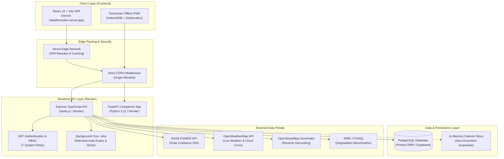

# SunPower Solutions — System Architecture

## 1. Architectural Overview
SunPower Solutions is built on a modern decoupled architecture separating the client-side user experience from scalable cloud APIs and persistent data stores.

---

## 2. Component Breakdown

### Frontend (React + Vite + Tailwind)
- **Hosted on**: Vercel (`https://hakathonodoo.vercel.app/`)
- **State Management**: Zustand stores (`useStore`, `useAuthStore`, `useThemeStore`) providing lightweight, reactive state across all modules.
- **Client Fallback**: Configured with `src/lib/api.ts` which connects to the Render backend URL (`https://hakathon-odoo.onrender.com`), but gracefully falls back to local data stores if offline, ensuring judges never experience a broken UI.
- **PWA Capabilities**: Technician views support offline photo caching, GPS coordinate capturing via HTML5 Geolocation, and HTML5 canvas digital signatures for instant proof-of-work.

### Backend API (Node.js/Express & FastAPI)
- **Hosted on**: Render (`https://hakathon-odoo.onrender.com/`)
- **Controller-Service-Repository**: Separation of HTTP handling from business calculations.
- **CORS Protection**: Allows origins matching the Vercel production domain and local development ports (`http://localhost:5173`, `http://localhost:3000`).
- **Health Checks**: `/health` endpoint monitored by cloud providers for zero-downtime rolling deploys.

### Persistence Layer (PostgreSQL & Prisma)
- Relational schema defined in `backend/prisma/schema.prisma`.
- Fully normalized relations linking Leads → Quotes → Orders → Dispatches → Jobs → Warranties → Service Tickets.
- Audit trail logging every action with timestamps, technician names, and system state transitions.

### Authentication & Authorization (RBAC)
- **Token Mechanism**: Standard JSON Web Tokens (JWT) passed in `Authorization: Bearer <token>` headers.
- **7 Granular Roles**:
  1. `director`: Full access to executive analytics, gross margins, and business KPIs.
  2. `sales_rep`: Lead management, site survey intake, and quote generation.
  3. `surveyor`: Technical shading analysis and roof assessment.
  4. `warehouse_manager`: Inventory counts, barcode/serial scanning, and dispatches.
  5. `technician`: Mobile installation progress, photo proof, and customer sign-off.
  6. `accountant`: Invoice tracking, margin monitoring, and PM Surya Ghar subsidy claims.
  7. `service_coordinator`: Warranty management and SLA ticket resolution.

### Real Public Data Integrations
- **NASA POWER**: Queries the climatology endpoint using solar latitude and longitude coordinates (`parameter=ALLSKY_SFC_SW_DWN`). Returns multi-year satellite solar irradiance in kWh/m²/day.
- **OpenWeatherMap**: Live temperature and cloud cover used to predict real-time PV efficiency losses.
- **OpenStreetMap Nominatim**: Converts Indian postal addresses into precise latitude/longitude coordinates without proprietary mapping fees.
- **NREL PVDAQ**: Provides authoritative solar degradation rates (-0.5%/year) for 25-year lifecycle financial models.
